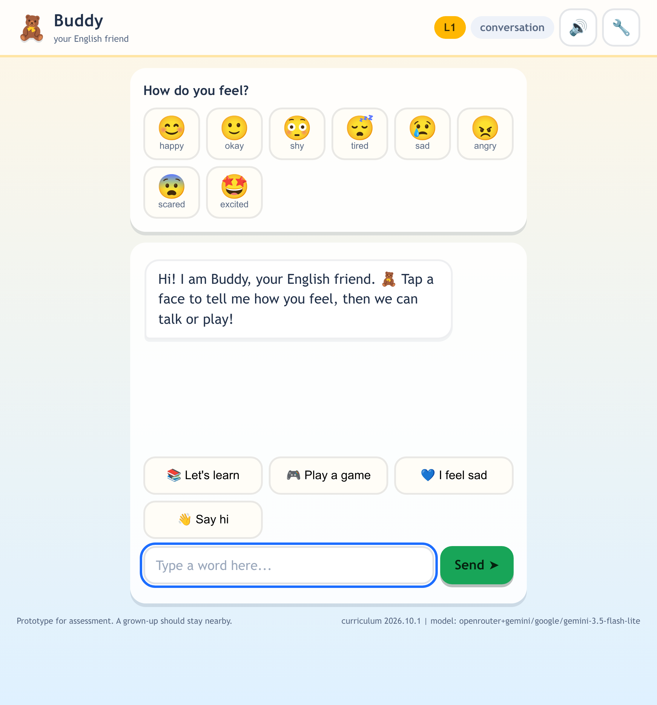

# BRIMSEL Kids English Chatbot

A warm English tutor for children **under 7**. Buddy chats, plays and practises
words, phrases and little sentences — and every decision that affects a child's
progress is made by deterministic code, not by a language model.

> **Code decides. The model only speaks.**

A slow API, a rate limit, a hallucination or a total provider outage cannot move
a child up a level, mark them wrong, or leave them without a reply.

**Live:** _see the ["Live URL"](#live-url) section at the bottom of this file._



---

## Contents

- [What it does](#what-it-does)
- [Quick start](#quick-start)
- [Configuration](#configuration)
- [Voice](#voice)
- [Tests](#tests)
- [Measured latency](#measured-latency)
- [How it works](#how-it-works)
- [Deploy](#deploy)
- [Project layout](#project-layout)
- [Security and privacy](#security-and-privacy)
- [Accessibility and child-safety choices](#accessibility-and-child-safety-choices)
- [Live URL](#live-url)

---

## What it does

**Four modes, one per turn, with a strict priority.**

| Mode | What the child gets |
| --- | --- |
| **Support** | Comfort only, never a quiz. A worrying disclosure always points to a trusted adult. |
| **Engagement** | A game or a movement break, and the learning streak is reset. |
| **Conversation** | Warm chat. This is the default when signals are unclear — a child is never forced into a lesson. |
| **Learning** | One word, phrase or sentence at a time, scored, with gentle hints. |

Support outranks Engagement, which outranks Conversation, which outranks
Learning. After **3 consecutive learning turns** the engine forces Engagement —
the learning streak is capped at 3, so the child cannot be drilled.

**Three levels, one versioned curriculum file.**

| Level | Focus | Items |
| --- | --- | --- |
| 1 | Words and sounds — letters, colours, animals | 20 |
| 2 | Small phrases — noun plus verb, 2–3 words | 12 |
| 3 | Little sentences, questions, tiny stories | 10 |

Content lives in `data/curriculum.json` (version `2026.10.1`). Changing what the
child learns is a content change, not a code change.

**Progression is arithmetic, and it is unit-tested.**

- **Promote** after at least 8 attempts at the level and at least 4 of the last 5
  correct.
- **Ease** after 3 misses in a row: a hint, and the weakest item comes back.
- **Demote** as a safety net if a child promoted too early is struggling.

Non-answers ("um", an emoji, an empty send) never count as an attempt, so
promotion cannot be farmed by pressing send.

**It speaks with a natural voice, not the browser's robot.**

Replies are synthesised server-side by a neural voice and returned as
`audio/mpeg`. The markup is assembled in code from the model's intent, never
written by the model, so no malformed or hostile tag can reach the synthesiser.
Results are cached in-process: a repeat phrase is served with 0 ms of server
time. If speech is unavailable the browser voice takes over, so a turn is never
broken by audio.

**A level control, for reviewing only.**

`L1 / L2 / L3` in the header jumps straight to a level so a reviewer can see
level-2 and level-3 content without earning promotion first. It is labelled
"demo control" and does not replace the rule above: left alone, promotion still
happens on its own. Switching clears that level's attempts and accuracy window
so it starts clean, and keeps the conversation and per-item mastery.

**It fits a small laptop, and the input box never scrolls away.**

Every size is fluid (`clamp()` and viewport units) rather than a fixed pixel
value, so the app fits a 1366×768 screen at 100% zoom — no need to zoom out.
The page itself never scrolls; the message list is the only scrolling area, so
the composer stays put however long the conversation gets. Nothing shrinks below
the accessibility floor: 15px body text, 48px tap targets.

---

## Quick start

Requires Python 3.12.

```bash
git clone <this-repo> && cd brimsel-kids-chatbot
python -m venv .venv && . .venv/bin/activate
pip install -r requirements.txt

cp .env.example .env        # then put a real key in .env
python -m uvicorn app.main:app --port 8080
```

Open <http://127.0.0.1:8080>.

**No API key? It still works.** Without a key the engine replies from its
deterministic child-safe templates — the whole app, the modes, the scoring and
the progression are fully functional. Only the wording stops being generated.

### Try it in 30 seconds

```bash
python scripts/smoke.py http://127.0.0.1:8080
python scripts/smoke.py http://127.0.0.1:8080 --turns 30   # latency sample
```

---

## Configuration

Everything is environment-based; see [`.env.example`](.env.example).

| Variable | Default | Purpose |
| --- | --- | --- |
| `LLM_PROVIDER` | auto | `groq`, `openrouter`, `gemini` or `none` |
| `GROQ_API_KEY` | — | enables the Groq adapter (free tier, fastest free option) |
| `OPENROUTER_API_KEY` | — | enables the OpenRouter adapter |
| `GEMINI_API_KEY` | — | enables the Gemini adapter |
| `GROQ_MODEL` | `llama-3.3-70b-versatile` | lead model when Groq is chosen |
| `OPENROUTER_MODEL` | `google/gemini-3.5-flash-lite` | lead model when OpenRouter is chosen |
| `GEMINI_MODEL` | `gemini-3.5-flash` | Gemini model |
| `LLM_FALLBACK_PROVIDER` | auto | backup provider; a second key is used if present |
| `LLM_TIMEOUT_MS` | `1800` | hard per-call ceiling |
| `LLM_MAX_TOKENS` | `48` | reply length ceiling |
| `GEMINI_THINKING_BUDGET` | `0` | `0` = answer immediately; `none` for models that reject `0` |
| `SPEECH_PROVIDER` | `edge` | `edge` for the neural voice, `none` to disable |
| `SPEECH_VOICE` | `en-US-AvaMultilingualNeural` | any `edge-tts --list-voices` name |
| `SPEECH_TIMEOUT_MS` | `8000` | give up on audio and let the client fall back |
| `CURRICULUM_PATH` | `./data/curriculum.json` | point at a different curriculum |
| `PORT` | `8080` | server port |

Leave `LLM_PROVIDER` unset to pick automatically: the first key present, in the
order **groq → gemini → openrouter**. Whichever key is present but not chosen
becomes a **backup inside one shared time budget**, so one provider's rate limit
does not cost the child a reply.

> **A note on the free providers, because this mattered.** The project started on
> OpenRouter, whose key reported `is_free_tier: true` with `total_credits: 0` while
> pointed at a **paid** model — it worked on an undocumented allowance, so it could
> have failed silently. Direct Gemini free-tier keys answer `429` under rapid turns.
> Groq is therefore the preferred lead: its free tier has an explicit quota. Add a
> key from <https://console.groq.com/keys> and set `LLM_PROVIDER=groq`; until then
> the deployment stays on the measured-good OpenRouter + Gemini pairing.

Speech needs **no key and no billing account**. That is the whole reason it is a
neural voice rather than Google Cloud Text-to-Speech or Vertex AI: both of those
require billing to be enabled on the project, and it is not.

> The `GEMINI_THINKING_BUDGET` knob exists for a real reason: `gemini-3.5-flash-lite`
> answers `400` to `thinkingBudget: 0`, while `gemini-3.5-flash` needs it to stay
> fast. Set it to `none` for the former.

### API

| Route | Purpose |
| --- | --- |
| `GET /` | the child's UI (static, no build step) |
| `POST /api/session` | new session + opening line |
| `POST /api/chat` | one complete turn |
| `POST /api/level` | jump to a level and return the first item (demo control) |
| `GET /api/warm` | the three level openers, so the client can pre-compose them |
| `POST /api/speech` | reply text → `audio/mpeg` from the neural voice |
| `GET /api/health` | liveness, provider, curriculum version, voice (no secrets) |
| `GET /api/metrics` | live p50/p95 from real traffic |
| `GET /api/curriculum` | curriculum version and level summary |

---

## Voice

**What it is.** Replies are spoken by `edge-tts`'s neural voice
(`en-US-AvaMultilingualNeural` by default), synthesised by the server and
returned from `POST /api/speech` as `audio/mpeg`.

**Why not Google Cloud Text-to-Speech.** Vertex AI and Cloud TTS both need a
**billing account enabled** on the project, and it is not enabled — so that route
is closed rather than merely harder. `edge-tts` needs no key and no billing, which
is why it was chosen. The browser's `SpeechSynthesis` remains as the fallback if
the endpoint is ever unavailable.

**Why the model does not write the SSML.** The model is asked for *intent* —
"this should be gentle", "the word `cat` matters" — and the server assembles the
document. The synthesiser accepts exactly one document shape and silently returns
`NoAudioReceived` for anything else, so a wrong document is *silent* rather than
loud. `scripts/speech_probe.py --section ssml` is the evidence:

| Document | Result |
| --- | --- |
| `<prosody rate='-50%'>` | honoured (1.87 s → 2.90 s) |
| `<prosody rate='+100%'>` | honoured (1.87 s → 0.77 s) |
| `<break time='700ms'/>` | **rejected** |
| `<emphasis level='strong'>` | **rejected** |
| nested `<prosody>` | **rejected** |
| a tag bare in `<voice>` | **rejected** |

So only a single `<prosody>` inside `<voice>` is sent, and its rate is derived
from the mode, whether the answer was right, and the model's energy hint. The
builder is pinned to `edge_tts.communicate.mkssml`'s own output by a test, so the
wire format is verified rather than assumed.

**Why the client cannot inject markup.** The browser sends plain text and three
clamped values (mode, correct, speed). It never sends SSML, because there is no
parameter for it. Emoji are stripped rather than read aloud, control characters
are removed, and the text is capped at 400 characters.

**Why the voice sometimes arrives after the text.** This is the accepted cost of
moving from the browser's `SpeechSynthesis` to a real neural voice. The browser
voice is local, so it starts instantly — and sounds robotic, which is what the
first version did. A server-side voice has to travel to the synthesiser and back:
measured on the live service, a cold phrase costs **2311–3246 ms** server-side,
while a cache hit costs **0 ms**.

None of the obvious delivery fixes help, so none were adopted:

| Idea | What the measurement said |
| --- | --- |
| Stream the audio instead of sending it whole | the synthesiser emits its first audio chunk only at the end of its own ~3 s; first byte and last byte land within ~200 ms of each other |
| Pool the connection to the synthesiser | each synthesis opens its own websocket and closes it; repeat calls stayed at 2.1–3.8 s |
| A websocket to the browser | the browser is not the slow part — the round trip to the synthesiser is |
| A faster voice | an interleaved benchmark of four `en-US` voices finished within 0.77–0.88 s of each other, i.e. voice choice is noise beside the endpoint's variance |

So the fix is to stop paying twice for sentences the server already knows. Every
route that returns Buddy's next line **pre-composes that exact sentence in the
background** (`SpeechService.prewarm`), and the browser's own request for the
audio *joins* that running synthesis rather than starting a second one. The
opener of each level is a fixed sentence, so the client asks for all three on
page load via `GET /api/warm` — that is what makes a level jump sound instant.
Measured locally: a level jump returns its audio in **19–46 ms** once warm,
against ~3 s cold.

**A warm-up can never break a turn.** If it is slow it is abandoned after 5 s
(`PREWARM_TIMEOUT_S`) rather than the full 8 s, and if it fails the child's own
request simply synthesises from scratch with the time that remains. Speech is an
enhancement, so it is never the reason a turn fails.

**And one slow phrase can never change the voice.** The client waits for the
server's own verdict (9000 ms, above the server's 8000 ms ceiling) before falling
back, a timeout is treated as "too slow" rather than "broken", and the browser
voice is only latched after `SPEECH_FAIL_LIMIT` consecutive real failures. When
it is used, the fallback is pinned to a non-male `en-US` voice so the child does
not hear a different person mid-lesson.

---

## Tests

```bash
python -m pytest        # 288 passed
```

Fully offline: an autouse fixture strips every API key and installs a null
provider, so the suite never touches the network and cannot be flaky because an
API is slow.

| File | Covers |
| --- | --- |
| `tests/test_progression.py` | promotion at exactly 8 attempts / 4-of-5; no promotion at 7 attempts or 3-of-5; easing after exactly 3 misses; demotion; mastery boxes; deterministic item selection |
| `tests/test_modes.py` | all four modes; the full priority order; the 3-learning-turn ceiling; play requests vs learn requests; greeting, boredom and pause signals; unclear → Conversation |
| `tests/test_safety.py` | input blocking, PII scrubbing, worry detection, tone rules (never "wrong"), output filtering, and **every** fallback context producing a safe, in-budget reply |
| `tests/test_engine.py` | whole conversations end to end: level changes, streak reset, persistence across a refresh, tamper resistance, one model call per turn |
| `tests/test_llm.py` | parsing, HTTP 429/500, dead socket, enforced wall-clock timeout, provider chain, thinking-budget payload, provider selection (Groq leading, OpenRouter and Gemini as fallbacks) |
| `tests/test_api.py` | routes, status codes, `X-Response-Time-Ms`, empty input, metrics |
| `tests/test_speech.py` | prosody mapping and clamping, emoji stripping, the **SSML wire format checked against `edge-tts`' own builder**, one-request synthesis, the cache, timeout, the 503 fallback contract, and that a client cannot inject markup |
| `tests/test_level_switch.py` | the demo level control: what a jump clears (level counters) and what it must keep (mastery, conversation), clamping, that it never calls the model, and that ordinary promotion still works afterwards |
| `tests/test_static.py` | UI contracts: the `[hidden]` guard, panels starting hidden, the settings panel only reserving a column when open, fluid sizing, the message list being the only scroll region, stale audio never playing over a newer reply, and a scan proving no key, provider or model name reaches the browser |

Every requirement called out in the brief maps to a named test; see
[`docs/system-design.md`](docs/system-design.md#11-testing).

---

## Measured latency

Measured against the **live deployment**. Reproduce with:

```bash
python scripts/smoke.py <url> --turns 60     # drives real turns and times them
curl <url>/api/metrics                       # the engine's own cumulative record
```

The smoke script deliberately reports **three** numbers, because one number
cannot be honest here: the client's view (what the child waits for), the
server's view (what the app controls), and the difference (the network hop,
which no app can control).

### 1. The engine's own turn — 417 live turns

This is the number the implementation is responsible for.

| Metric | Value |
| --- | --- |
| Turns | **417** |
| **p50** | **589 ms** |
| **p95** | **792 ms** |
| mean | 587 ms |
| max | 1804 ms (exactly the configured ceiling) |
| Model calls | 391 |
| Model calls that succeeded | **388 (99.2%)** |
| Turns answered from the deterministic fallback | 29 (7.0%) |

Per mode, server-side p50 / p95: Learning 591 / 806 ms · Engagement 599 / 746 ms ·
Conversation 609 / 783 ms · **Support 0 / 0 ms** (Support never calls the model).

### 2. End-to-end, client-measured — two consecutive 60-turn runs

| Metric | Run 1 | Run 2 |
| --- | --- | --- |
| Samples | 60 | 60 |
| **p50** | **1084 ms** | **1082 ms** |
| **p95** | **1615 ms** | **1265 ms** |
| min | 419 ms | 410 ms |
| max | 10513 ms | 1451 ms |
| Fallback replies | 4 | 4 |

### 3. The network hop, isolated

20 bare `GET /api/health` calls per run — no model, no state, so essentially pure
network round trip from the measuring workstation to `us-central1`:

| Metric | Run 1 | Run 2 |
| --- | --- | --- |
| hop p50 | 442 ms | 461 ms |
| hop p95 | 514 ms | 582 ms |

**Reading these numbers honestly.**

- **The p50 of ~1.08 s is ~0.49 s of app and ~0.45 s of network.**
  `client p50 − server p50` measured 471 ms and 438 ms in the two runs, which
  matches the bare-GET hop of 442 ms and 461 ms. The app's share is the
  589–628 ms the engine reports for itself.
- **The engine's p95 is 792 ms, comfortably inside the two-second budget, and its
  maximum is 1804 ms — exactly the configured `LLM_TIMEOUT_MS` ceiling.** The
  hard cap is real: it held across all 417 turns.
- **The 10.5 s client outlier was the network, not the app.** In that same run the
  engine's own maximum was 1212 ms, and the isolated hop measurements in the same
  run reached large values too. The measuring sandbox's link to `us-central1` is
  variable; a single stalled request explains the tail entirely. Run 2, taken
  minutes later on the same revision, has a 1451 ms maximum.
- **Only 3 of the 29 fallbacks were model failures.** 26 were Support turns,
  which by design never call the model. So the model answered on **99.2%** of the
  turns where it was actually asked to speak.
- **Sample sizes: 417 server-side turns, 120 client-side turns, 40 hop probes.**
  No longer run has been measured.

Two mechanisms keep this bounded, and one decides whether the model speaks:

1. **Hard per-call timeout** — `LLM_TIMEOUT_MS`, default 1800 ms, enforced with
   `asyncio.wait_for` (an `httpx` timeout alone is per-socket-operation and a slow
   body can outlive it).
2. **A deterministic reply built before the model is called** — if the model is
   too slow, the turn still ends with a real, child-safe sentence.
3. **Model chosen by measurement** — `scripts/bench_models.py` times candidates
   against the real prompt.

**Honest limitation.** Upstream latency was *highly variable* during development:
the same model with the same prompt ranged from **0.85 s to 7.3 s** depending on
the moment. No single upstream can be trusted to be fast. That volatility — not
the average — is why the fallback is a first-class reply rather than an error
path. Model benchmark, p50 over 4–5 samples each:

| Model | p50 |
| --- | --- |
| `google/gemini-2.5-flash` (OpenRouter) | 0.90 s |
| `google/gemini-3.5-flash-lite` (OpenRouter) ← in production | 1.34 s |
| `openai/gpt-4o-mini` (OpenRouter) | 1.75 s |
| `gemini-3.5-flash` (Gemini API) ← backup | 1.83 s |
| `gemini-3.1-flash-lite` (Gemini API) | 2.76 s |

### 4. Speech — measured on the live revision, not estimated

Speech was added in this revision and measured the same way. It is deliberately
**off the critical path**: the text renders first and the audio is fetched after,
so no speech cost appears in the turn numbers above.

Reproduce with `python scripts/speech_probe.py --base <url>`.

| Measurement | Result |
| --- | --- |
| Cold synthesis, short reply (**n=6**) | **p50 3311 ms**, min 2606 ms, max 4910 ms (server) |
| Cold synthesis, two-sentence reply | 1984 ms server in one sample; the spread above is more honest |
| One cold call exceeded the 8 s ceiling | the client fell back to the browser voice, as designed |
| Cache hit (`X-Speech-Cached: 1`) | **0 ms** server, ~390–500 ms client (pure hop) |
| Level jump after the client warms the openers | **19–46 ms** wall, `X-Speech-Cached: 1` (measured locally, n=4) |
| Client wait before falling back | **9000 ms** — deliberately above the server's 8000 ms ceiling, so the server decides |
| Server ceiling | 8000 ms (`SPEECH_TIMEOUT_MS`) |
| Speculative warm-up budget | 5000 ms (`PREWARM_TIMEOUT_S`) |

| Reply style | Audio length (bytes ÷ 6000) |
| --- | --- |
| Praise (`Learning`, correct) | 3.74 s |
| Comfort (`Support`) | 3.91 s |
| Play (`Engagement`) | 3.74 s |

**Two things were tried and rejected because the measurements said so.**

- **Synthesising each sentence separately** to get a slower final question and a
  pause between sentences. `scripts/speech_probe.py --section timing` shows the
  wall-clock grows with sentence count (3 sentences took **1.86×** the time of 2),
  so the connections are serialised, not concurrent. It bought a mildly different
  rate per sentence and cost latency in direct proportion to reply length. Removed.
  The neural voice already pauses at punctuation on its own.
- **Reading the duration as "the prosody was ignored".** Pitch and volume do not
  change how long a sentence takes, so they cannot be judged from duration. Only
  rate is verified that way, and the probe includes a control (3× the text must
  give ~3× the bytes) so the measurement cannot quietly become meaningless.

**Honest limitation: cold audio starts roughly three seconds after the reply
appears.** Measured over six short phrases: **p50 3311 ms**, min 2606 ms, max
4910 ms, and one earlier sample exceeded the 8 s server ceiling and fell back. A
cache hit is instant and the cache fills quickly, because the vocabulary is small
— so a *repeat* is free, but a *new* phrase costs about three seconds of synthesis.
The client waits **5 s** and then falls back to the browser voice, deliberately: the
child prefers the good voice, so waiting is right, but waiting 12 s in silence is
not. Streaming the audio to the browser as it is produced (rather than buffering
the whole MP3) is the obvious next step and was not implemented.

The first version of this voice — the browser's own `SpeechSynthesis` — was the
"absolutely robotic" audio in the bug report. It is now the fallback, not the
default.

### 5. Layout — verified by measuring the DOM, not by eye

The two layout bugs in the report were "the UI is too zoomed in on a small laptop"
and "the input box goes down and I have to scroll to write". Both are checked in
headless Chromium at 1366×768, 1280×720 and 390×844, with 30 turns injected to
reproduce a long conversation:

| Check | 1366×768 | 1280×720 | 390×844 |
| --- | --- | --- | --- |
| Page scrolls | no | no | no |
| Composer inside the viewport | yes | yes | yes |
| Message list is the scroll region | yes | yes | yes |
| Body font | 18 px | 17.9 px | 15 px |
| Tap target | 48 px | 48 px | 48 px |
| Quick-say row height | 45 px | 42 px | 48 px |
| Settings panel | 380×658 | 380×611 | 367×844 |
| Console errors | 0 | 0 | 0 |

---

## How it works


The short version: `plan_turn()` runs safety → mode → scoring → progression →
item choice → directive → **fallback reply**, and only then, if the mode warrants
it, is the model asked to speak. `finalize_turn()` filters whatever comes back and
commits the turn.

- Full design: [`docs/system-design.md`](docs/system-design.md)
- The agreed design page, exported: [`docs/brimsel-brief.md`](docs/brimsel-brief.md)
- Diagram source: [`docs/architecture.mmd`](docs/architecture.mmd)
- Two-minute demo script: [`docs/demo-script.md`](docs/demo-script.md)

A few decisions worth knowing:

**The session lives in the browser.** The server keeps no per-child state: the
session is an opaque JSON blob in `localStorage`, sent with each turn and clamped
field-by-field on the way in. So a refresh, a redeploy or a load-balancer hop
resumes the same lesson, the service scales to zero, and there is nothing to leak
because nothing is persisted server-side.

**The model is given `answered` and `target` as separate fields.** Early testing
produced *"Yes! dog!"* right after the child said *"cat"*. Splitting "the word you
just said" from "the word I am asking for" fixed it, and the deterministic
fallbacks are built from the same two fields — so the model and the fallback can
never disagree about which word was just said.

**Support turns never reach the model.** The comfort line is a hand-written
constant, and a worrying disclosure always names a trusted adult. Faster, and
safer.

---

## Deploy

One container, one process. Any host that runs a container works.

```bash
docker build -t brimsel-kids-chatbot .
docker run -p 8080:8080 --env-file .env brimsel-kids-chatbot
```

Cloud Run:

```bash
gcloud run deploy brimsel-kids-chatbot \
  --source . --region us-central1 --allow-unauthenticated \
  --min-instances 1 --memory 512Mi \
  --env-vars-file env.yaml      # never commit this file
```

`min-instances=1` removes cold starts from the measured numbers. The service is
stateless, so it can be scaled down or replaced at any time without losing a
child's lesson.

---

## Project layout

```
app/
  main.py          FastAPI routes, request models, metrics wiring
  engine.py        plan_turn / finalize_turn / advance — the whole turn
  modes.py         Support > Engagement > Conversation > Learning
  progression.py   mastery boxes, promote / ease / demote, item choice
  text.py          normalisation, answer scoring, input and output safety
  fallbacks.py     every deterministic child-safe reply
  prompts.py       system prompt, directive, user prompt
  llm.py           provider adapters and the latency-bounded chain
  speech.py        SSML assembly, the neural voice, and the audio cache
  state.py         session shape and tamper-resistant normalisation
  curriculum.py    loads and validates the versioned curriculum
  metrics.py       in-process latency recorder
data/curriculum.json   versioned curriculum — content, not code
static/                index.html, styles.css, app.js — no build step
tests/                 306 offline tests
scripts/smoke.py       public-URL smoke test + client-side latency
scripts/bench_models.py   model latency benchmark
scripts/progression_check.py  drives a live deployment L1 -> L2 -> L3
scripts/speech_probe.py       which SSML is honoured; cold vs cached audio
scripts/layout_check.js       headless-browser layout assertions (needs a server)
docs/                  design docs, the brief export, architecture diagram,
                       UI screenshot, demo script
Dockerfile             one image, one process
```

---

## Security and privacy

- **No API key ever reaches the browser.** The front end has no key, no provider
  URL and no model name; it only talks to `/api/chat`. Health output reports
  which provider is configured, never the credential.
- **No server-side persistence.** Nothing a child says is written to disk or to a
  database. The session blob lives in the child's own browser, which also means
  it is device-local rather than private-within-the-browser storage.
- **No accounts, no personal data.** Emails, phone numbers and URLs in a child's
  message are replaced with a placeholder before the turn continues.
- **Session blobs are untrusted.** They round-trip through the browser, so
  `normalize_state()` rebuilds every field and clamps it. Editing `localStorage`
  to claim `"level": 99` yields level 3.
- **Unsafe input is never forwarded to the model,** and is stored as
  `[hidden for safety]` so the string is not preserved either.
- `.env` is git-ignored, `.dockerignore` excludes it from images, and
  `.env.example` contains placeholders only.

---

## Accessibility and child-safety choices

- **Works without a microphone.** Text chat and tappable suggestion buttons are
  the primary path. Browser speech input is a progressive enhancement and is
  never required.
- **Big targets, big text.** Buttons and text are sized for small hands and
  early readers; the layout is responsive down to phone width.
- **One question per turn.** No dense paragraphs, no lists, no timers, no
  losing streaks that a child can see.
- **Mood check-in with emoji faces**, which also feeds mode selection — a sad
  face is comforted, not quizzed.
- **Effort is praised, ability is not.** The word "wrong" never appears. A miss
  is *"Almost! Let's try together."*
- **A worrying disclosure is never diagnosed.** The reply offers comfort and
  points to a trusted adult.
- **Read-aloud.** Where the browser supports it, Buddy's replies can be spoken
  for pre-readers.

---

## Live URL

**https://brimsel-kids-chatbot-153163979718.us-central1.run.app**

Deployed on Google Cloud Run (`us-central1`, `min-instances=1`), HTTPS, publicly
reachable. Health check: [`/api/health`](https://brimsel-kids-chatbot-153163979718.us-central1.run.app/api/health)
reports the active provider, the model and the curriculum version — never a
credential.

- Source: <https://github.com/asifdotpy/brimsel-kids-chatbot> (private)
- Architecture image: [`docs/architecture.png`](docs/architecture.png)
- Design document: [`docs/system-design.md`](docs/system-design.md)
- Two-minute demo script: [`docs/demo-script.md`](docs/demo-script.md)
