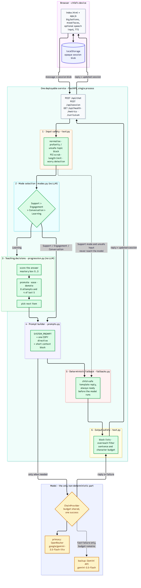

# BRIMSEL Kids English Chatbot

A warm English tutor for children **under 7**. Buddy chats, plays and practises
words, phrases and little sentences — and every decision that affects a child's
progress is made by deterministic code, not by a language model.

> **Code decides. The model only speaks.**

A slow API, a rate limit, a hallucination or a total provider outage cannot move
a child up a level, mark them wrong, or leave them without a reply.

**Live:** _see the "Live URL" section at the bottom of this file._

---

## Contents

- [What it does](#what-it-does)
- [Quick start](#quick-start)
- [Configuration](#configuration)
- [Tests](#tests)
- [Measured latency](#measured-latency)
- [How it works](#how-it-works)
- [Deploy](#deploy)
- [Project layout](#project-layout)
- [Security and privacy](#security-and-privacy)
- [Accessibility and child-safety choices](#accessibility-and-child-safety-choices)

---

## What it does

**Four modes, one per turn, with a strict priority.**

| Mode | What the child gets |
| --- | --- |
| **Support** | Comfort only, never a quiz. A worrying disclosure always points to a trusted adult. |
| **Engagement** | A game or a movement break, and the learning streak is reset. |
| **Conversation** | Warm chat. This is the default when signals are unclear — a child is never forced into a lesson. |
| **Learning** | One word, phrase or sentence at a time, scored, with gentle hints. |

Support outranks Engagement, which outranks Conversation, which outranks
Learning. After **3 consecutive learning turns** the engine forces Engagement —
the learning streak is capped at 3, so the child cannot be drilled.

**Three levels, one versioned curriculum file.**

| Level | Focus | Items |
| --- | --- | --- |
| 1 | Words and sounds — letters, colours, animals | 20 |
| 2 | Small phrases — noun plus verb, 2–3 words | 12 |
| 3 | Little sentences, questions, tiny stories | 10 |

Content lives in `data/curriculum.json` (version `2026.10.1`). Changing what the
child learns is a content change, not a code change.

**Progression is arithmetic, and it is unit-tested.**

- **Promote** after at least 8 attempts at the level and at least 4 of the last 5
  correct.
- **Ease** after 3 misses in a row: a hint, and the weakest item comes back.
- **Demote** as a safety net if a child promoted too early is struggling.

Non-answers ("um", an emoji, an empty send) never count as an attempt, so
promotion cannot be farmed by pressing send.

---

## Quick start

Requires Python 3.12.

```bash
git clone <this-repo> && cd brimsel-kids-chatbot
python -m venv .venv && . .venv/bin/activate
pip install -r requirements.txt

cp .env.example .env        # then put a real key in .env
python -m uvicorn app.main:app --port 8080
```

Open <http://127.0.0.1:8080>.

**No API key? It still works.** Without a key the engine replies from its
deterministic child-safe templates — the whole app, the modes, the scoring and
the progression are fully functional. Only the wording stops being generated.

### Try it in 30 seconds

```bash
python scripts/smoke.py http://127.0.0.1:8080
python scripts/smoke.py http://127.0.0.1:8080 --turns 30   # latency sample
```

---

## Configuration

Everything is environment-based; see [`.env.example`](.env.example).

| Variable | Default | Purpose |
| --- | --- | --- |
| `LLM_PROVIDER` | `openrouter` | `openrouter`, `gemini` or `none` |
| `OPENROUTER_API_KEY` | — | enables the OpenRouter adapter |
| `GEMINI_API_KEY` | — | enables the Gemini adapter |
| `OPENROUTER_MODEL` | `google/gemini-3.5-flash-lite` | lead model |
| `GEMINI_MODEL` | `gemini-3.5-flash` | backup model |
| `LLM_FALLBACK_PROVIDER` | auto | backup provider; the other key is used if present |
| `LLM_TIMEOUT_MS` | `1800` | hard per-call ceiling |
| `LLM_MAX_TOKENS` | `48` | reply length ceiling |
| `GEMINI_THINKING_BUDGET` | `0` | `0` = answer immediately; `none` for models that reject `0` |
| `CURRICULUM_PATH` | `./data/curriculum.json` | point at a different curriculum |
| `PORT` | `8080` | server port |

If both keys are present the second becomes a **backup inside one shared time
budget**, so one provider's rate limit does not cost the child a reply.

> The `GEMINI_THINKING_BUDGET` knob exists for a real reason: `gemini-3.5-flash-lite`
> answers `400` to `thinkingBudget: 0`, while `gemini-3.5-flash` needs it to stay
> fast. Set it to `none` for the former.

### API

| Route | Purpose |
| --- | --- |
| `GET /` | the child's UI (static, no build step) |
| `POST /api/session` | new session + opening line |
| `POST /api/chat` | one complete turn |
| `GET /api/health` | liveness, provider, curriculum version (no secrets) |
| `GET /api/metrics` | live p50/p95 from real traffic |
| `GET /api/curriculum` | curriculum version and level summary |

---

## Tests

```bash
python -m pytest        # 187 passed
```

Fully offline: an autouse fixture strips every API key and installs a null
provider, so the suite never touches the network and cannot be flaky because an
API is slow.

| File | Covers |
| --- | --- |
| `tests/test_progression.py` | promotion at exactly 8 attempts / 4-of-5; no promotion at 7 attempts or 3-of-5; easing after exactly 3 misses; demotion; mastery boxes; deterministic item selection |
| `tests/test_modes.py` | all four modes; the full priority order; the 3-learning-turn ceiling; play requests vs learn requests; greeting, boredom and pause signals; unclear → Conversation |
| `tests/test_safety.py` | input blocking, PII scrubbing, worry detection, tone rules (never "wrong"), output filtering, and **every** fallback context producing a safe, in-budget reply |
| `tests/test_engine.py` | whole conversations end to end: level changes, streak reset, persistence across a refresh, tamper resistance, one model call per turn |
| `tests/test_llm.py` | parsing, HTTP 429/500, dead socket, enforced wall-clock timeout, provider chain, thinking-budget payload, provider selection |
| `tests/test_api.py` | routes, status codes, `X-Response-Time-Ms`, empty input, metrics |

Every requirement called out in the brief maps to a named test; see
[`docs/system-design.md`](docs/system-design.md#11-testing).

---

## Measured latency

Measured **end-to-end, client-side**, against the live deployment — including the
network hop, because that is what a child actually experiences. Reproduce with
`python scripts/smoke.py <url> --turns 30`.

The engine records its own view at `GET /api/metrics`, so these numbers come from
real traffic rather than a synthetic benchmark.

| Metric | Value |
| --- | --- |
| Turns measured | _filled in after deployment_ |
| p50 end-to-end | _filled in after deployment_ |
| p95 end-to-end | _filled in after deployment_ |
| Max | _filled in after deployment_ |
| Model calls succeeded | _filled in after deployment_ |

Two mechanisms keep this bounded, and one decides whether the model speaks:

1. **Hard per-call timeout** — `LLM_TIMEOUT_MS`, default 1800 ms, enforced with
   `asyncio.wait_for` (an `httpx` timeout alone is per-socket-operation and a slow
   body can outlive it).
2. **A deterministic reply built before the model is called** — if the model is
   too slow, the turn still ends with a real, child-safe sentence.
3. **Model chosen by measurement** — `scripts/bench_models.py` times candidates
   against the real prompt.

**Honest limitation.** Upstream latency was *highly variable* during development:
the same model with the same prompt ranged from **0.85 s to 7.3 s** depending on
the moment. No single upstream can be trusted to be fast. That volatility — not
the average — is why the fallback is a first-class reply rather than an error
path. Model benchmark, p50 over 4–5 samples each:

| Model | p50 |
| --- | --- |
| `google/gemini-2.5-flash` (OpenRouter) | 0.90 s |
| `google/gemini-3.5-flash-lite` (OpenRouter) | 1.34 s |
| `openai/gpt-4o-mini` (OpenRouter) | 1.75 s |
| `gemini-3.5-flash` (Gemini API) | 1.83 s |
| `gemini-3.1-flash-lite` (Gemini API) | 2.76 s |

---

## How it works



The short version: `plan_turn()` runs safety → mode → scoring → progression →
item choice → directive → **fallback reply**, and only then, if the mode warrants
it, is the model asked to speak. `finalize_turn()` filters whatever comes back and
commits the turn.

- Full design: [`docs/system-design.md`](docs/system-design.md)
- Diagram source: [`docs/architecture.mmd`](docs/architecture.mmd)
- Two-minute demo script: [`docs/demo-script.md`](docs/demo-script.md)

A few decisions worth knowing:

**The session lives in the browser.** The server keeps no per-child state: the
session is an opaque JSON blob in `localStorage`, sent with each turn and clamped
field-by-field on the way in. So a refresh, a redeploy or a load-balancer hop
resumes the same lesson, the service scales to zero, and there is nothing to leak
because nothing is persisted server-side.

**The model is given `answered` and `target` as separate fields.** Early testing
produced *"Yes! dog!"* right after the child said *"cat"*. Splitting "the word you
just said" from "the word I am asking for" fixed it, and the deterministic
fallbacks are built from the same two fields — so the model and the fallback can
never disagree about which word was just said.

**Support turns never reach the model.** The comfort line is a hand-written
constant, and a worrying disclosure always names a trusted adult. Faster, and
safer.

---

## Deploy

One container, one process. Any host that runs a container works.

```bash
docker build -t brimsel-kids-chatbot .
docker run -p 8080:8080 --env-file .env brimsel-kids-chatbot
```

Cloud Run:

```bash
gcloud run deploy brimsel-kids-chatbot \
  --source . --region us-central1 --allow-unauthenticated \
  --min-instances 1 --memory 512Mi \
  --env-vars-file env.yaml      # never commit this file
```

`min-instances=1` removes cold starts from the measured numbers. The service is
stateless, so it can be scaled down or replaced at any time without losing a
child's lesson.

---

## Project layout

```
app/
  main.py          FastAPI routes, request models, metrics wiring
  engine.py        plan_turn / finalize_turn / advance — the whole turn
  modes.py         Support > Engagement > Conversation > Learning
  progression.py   mastery boxes, promote / ease / demote, item choice
  text.py          normalisation, answer scoring, input and output safety
  fallbacks.py     every deterministic child-safe reply
  prompts.py       system prompt, directive, user prompt
  llm.py           provider adapters and the latency-bounded chain
  state.py         session shape and tamper-resistant normalisation
  curriculum.py    loads and validates the versioned curriculum
  metrics.py       in-process latency recorder
data/curriculum.json   versioned curriculum — content, not code
static/                index.html, styles.css, app.js — no build step
tests/                 187 offline tests
scripts/smoke.py       public-URL smoke test + client-side latency
scripts/bench_models.py   model latency benchmark
docs/                  system design, architecture diagram, demo script
Dockerfile             one image, one process
```

---

## Security and privacy

- **No API key ever reaches the browser.** The front end has no key, no provider
  URL and no model name; it only talks to `/api/chat`. Health output reports
  which provider is configured, never the credential.
- **No server-side persistence.** Nothing a child says is written to disk or to a
  database. The session blob lives in the child's own browser, which also means
  it is device-local rather than private-within-the-browser storage.
- **No accounts, no personal data.** Emails, phone numbers and URLs in a child's
  message are replaced with a placeholder before the turn continues.
- **Session blobs are untrusted.** They round-trip through the browser, so
  `normalize_state()` rebuilds every field and clamps it. Editing `localStorage`
  to claim `"level": 99` yields level 3.
- **Unsafe input is never forwarded to the model,** and is stored as
  `[hidden for safety]` so the string is not preserved either.
- `.env` is git-ignored, `.dockerignore` excludes it from images, and
  `.env.example` contains placeholders only.

---

## Accessibility and child-safety choices

- **Works without a microphone.** Text chat and tappable suggestion buttons are
  the primary path. Browser speech input is a progressive enhancement and is
  never required.
- **Big targets, big text.** Buttons and text are sized for small hands and
  early readers; the layout is responsive down to phone width.
- **One question per turn.** No dense paragraphs, no lists, no timers, no
  losing streaks that a child can see.
- **Mood check-in with emoji faces**, which also feeds mode selection — a sad
  face is comforted, not quizzed.
- **Effort is praised, ability is not.** The word "wrong" never appears. A miss
  is *"Almost! Let's try together."*
- **A worrying disclosure is never diagnosed.** The reply offers comfort and
  points to a trusted adult.
- **Read-aloud.** Where the browser supports it, Buddy's replies can be spoken
  for pre-readers.
