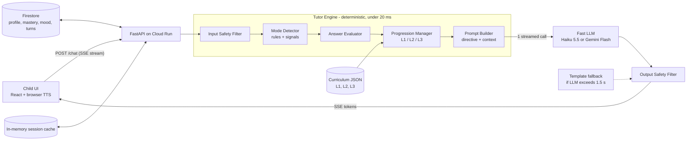
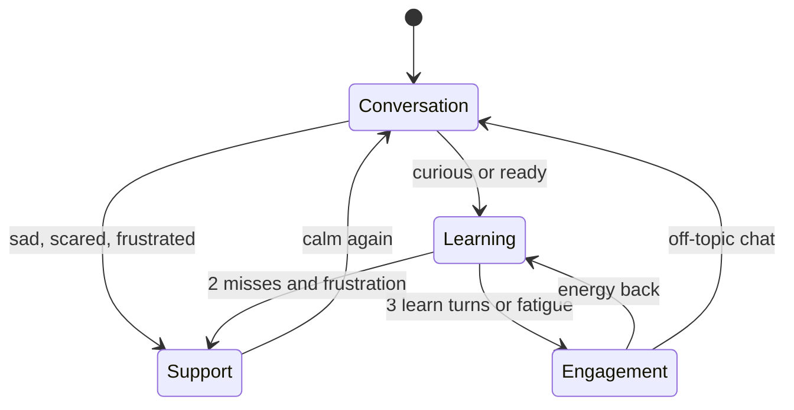

# BRIMSEL design page — exported for the repo

This is a verbatim export of the shared design page
(`app.notion.com/p/3fc6566cd8508162bccfd5cb1608a881`), kept in the repo so the
design that was agreed up front lives alongside the code that implements it.

Where the shipped implementation diverges from the plan below, it is deliberate
and is recorded in [`system-design.md`](system-design.md) §12:

| Planned here | Shipped | Why |
| --- | --- | --- |
| Vite + React UI | Vanilla HTML/CSS/JS, no build step | One deployable app, no toolchain to break |
| Firestore + in-memory session cache | No storage at all; the session is an opaque blob in browser `localStorage` | Stateless service, nothing to leak, refresh-safe |
| `--min-instances 1`, streaming via SSE | `--min-instances 1`, whole reply (no SSE) | A two-sentence reply is faster delivered whole, and the output safety filter must see the full text |
| Template fallback "if the LLM has not produced a first token within 1.5 s" | A deterministic reply is built **before** the call; hard `asyncio.wait_for` cap of 1800 ms | An `httpx` timeout is per-socket-operation, so a slow body could outlive it |
| Firestore data model (child / mastery / turn / session) | Bounded fields inside the session blob | See above; additive change behind `normalize_state()` if persistence is ever needed |

The measured latency, sample sizes and known limitations are reported in the
[README](../README.md#measured-latency).

---

<callout icon="🎯" color="blue_bg">
	**Goal:** English tutor chatbot for children under 7. Levels L1 to L3, mode switching, SEL, context-aware, under 2 s end-to-end. **Deadline:** Sun Oct 18, 2026, 7 PM (Dhaka time to confirm with BRIMSEL).
</callout>
<table_of_contents/>
# 1. Core design idea
**Code decides, the LLM only speaks.** Mode, level, answer correctness and progression are all computed deterministically in under 20 ms. The LLM gets one directive per turn and writes a short, warm, child-friendly reply. This gives us: one LLM call per turn (latency), predictable pedagogy (no level drift), easy testing, and a clean fallback when the LLM is slow.
# 2. Architecture diagram

## Mode state machine

# 3. Per-turn pipeline
1. **Input safety filter:** block or redirect unsafe content, strip personal info (address, full name, phone). Never ask for or store PII.
2. **Load state:** session cache first, Firestore on cold session only.
3. **Mode detection** (rules, no LLM): see section 5.
4. **Answer evaluation:** if the last bot turn asked a question, compare the child's reply to the expected answer (normalized, fuzzy match, accepts partial like "cat" for "a cat").
5. **Progression update:** update mastery, check promote or ease rules.
6. **Prompt builder:** system prompt plus a short directive, for example `mode=learn, level=2, target="apple", last_answer=correct, streak=3, mood=happy, praise=effort`.
7. **LLM call:** streamed, capped at about 40 tokens.
8. **Output filter:** length, vocabulary level, safety check. Stream to client via SSE.
9. **Async persist:** write turn, mastery and mood to Firestore after the response (not on the critical path).
# 4. Progressive learning (L1 to L3)
<table header-row="true">
<tr>
<td>Level</td>
<td>Focus</td>
<td>Example item</td>
<td>Response style</td>
</tr>
<tr>
<td>L1</td>
<td>Letters, colors, animals, single words (about 30 items)</td>
<td>"Can you say cat?"</td>
<td>1 short sentence, repeat the word, emoji support</td>
</tr>
<tr>
<td>L2</td>
<td>Nouns plus verbs, 2 to 3 word phrases (about 40 items)</td>
<td>"The cat is big." / "I see a dog."</td>
<td>1 to 2 short sentences, picture prompts</td>
</tr>
<tr>
<td>L3</td>
<td>Simple sentences, questions, tiny stories (about 40 items)</td>
<td>"What do you like to eat?"</td>
<td>2 short sentences, open questions</td>
</tr>
</table>
**Progression rules (in code):**
- Promote when at least 4 of the last 5 attempts are correct and at least 8 attempts at the current level.
- Ease when 3 misses in a row: give a hint, drop to an easier item, switch to Support or Engagement if frustration signals appear.
- Each item has a mastery box 0 to 3 (simple spaced repetition): correct moves it up, miss moves it down. Weak items are re-served later in the session and in future sessions.
- Curriculum lives in versioned JSON, so content changes need no code changes.
# 5. Child mode detection
<table header-row="true">
<tr>
<td>Mode</td>
<td>When</td>
<td>Bot behavior</td>
</tr>
<tr>
<td>Support</td>
<td>Sad, scared, angry words or emoji, "I can't", crying, 2 or more misses with frustration</td>
<td>Name the feeling, comfort, no teaching until calm</td>
</tr>
<tr>
<td>Engagement</td>
<td>Bored, very short or repeated replies, long pauses, 3 learn turns in a row</td>
<td>Game, rhyme, guessing game, silly sound, pick-an-emoji</td>
</tr>
<tr>
<td>Conversation</td>
<td>Child shares news, asks off-topic question, session start</td>
<td>Chat naturally, weave in one simple word at most</td>
</tr>
<tr>
<td>Learning</td>
<td>Child is curious or ready, or replies to a prompt correctly</td>
<td>One target item, one question, effort-based praise</td>
</tr>
</table>
**Priority:** Support over Engagement over Conversation or Learning.
**Anti-drill rule:** never more than 3 learning turns in a row.
**Signals:** keyword and emoji lexicon, reply length, repeated "no" or "don't know", reply time (sent by the client), recent miss streak. If signals conflict or are unclear, default to Conversation. No extra LLM call in the hot path.
# 6. Social and emotional learning (SEL)
- **Emotional awareness:** session starts with a tap-an-emoji feelings check-in. The bot names and normalizes feelings ("It's okay to feel shy").
- **Confidence:** praise effort, not just correctness ("You tried so hard!"). A miss is never called wrong, it is "almost, let's try together".
- **Curiosity:** the bot ends turns with a wondering question ("What sound do you think a cow makes?").
- **Positive learning behavior:** growth-mindset phrases, short breaks offered, celebration of streaks, calm breathing mini-game in Support mode.
- **Mood log:** per-turn mood tag stored, so the bot can open the next session with "Yesterday you felt happy, how do you feel today?" using the child's history.
# 7. Context-aware responses
Each prompt includes: current level, last 6 turns, mastered words, struggling words (box 0 to 1), last 3 moods, child's first name or nickname (no full name), and the current mode directive. Total prompt target under 600 tokens to keep time-to-first-token low.
# 8. Latency budget (target: p95 under 2 s)
<table header-row="true">
<tr>
<td>Step</td>
<td>Budget</td>
</tr>
<tr>
<td>Network round trip (client to Cloud Run)</td>
<td>about 100 to 200 ms</td>
</tr>
<tr>
<td>Engine (safety, mode, eval, progression, prompt)</td>
<td>under 20 ms</td>
</tr>
<tr>
<td>Session state (cache hit)</td>
<td>under 5 ms</td>
</tr>
<tr>
<td>LLM time to first token (small model, short prompt)</td>
<td>about 300 to 700 ms</td>
</tr>
<tr>
<td>Generation of about 40 tokens, streamed</td>
<td>about 400 to 800 ms</td>
</tr>
<tr>
<td>Total to full reply</td>
<td>about 1.0 to 1.7 s (first words visible in under 1 s)</td>
</tr>
</table>
**Safeguards:**
- Cloud Run min instances = 1 (no cold starts), warm LLM client at startup.
- Single LLM call per turn, hard cap on output tokens.
- If the LLM has not produced a first token within 1.5 s, send a pre-written curriculum template reply instead.
- Persistence is async, off the critical path.
- Every response carries a server-side latency header, shown in a small debug panel and in the demo video. A `/metrics` endpoint reports p50 and p95.
# 9. Tech stack and trade-offs
<table header-row="true">
<tr>
<td>Choice</td>
<td>Why</td>
<td>Trade-off</td>
</tr>
<tr>
<td>Hybrid: rules plus small LLM</td>
<td>Predictable pedagogy, low latency, testable</td>
<td>Less open-ended than a pure LLM tutor</td>
</tr>
<tr>
<td>Rule-based mode detection</td>
<td>Under 5 ms, no extra LLM call</td>
<td>Can miss subtle moods; mitigated by defaulting to Conversation</td>
</tr>
<tr>
<td>Fast small LLM (Haiku 5.5 default, Gemini Flash alternative) behind a provider adapter</td>
<td>Fast first token, cheap, good at short simple language</td>
<td>Less depth; fine for under-7 vocabulary. Final pick after a quick TTFT benchmark</td>
</tr>
<tr>
<td>FastAPI plus SSE streaming</td>
<td>Simple, async, first words appear early</td>
<td>Needs a streaming-friendly host</td>
</tr>
<tr>
<td>Vite + React static UI served by the same FastAPI service</td>
<td>One URL, one deploy, no CORS</td>
<td>Less scalable frontend hosting than a CDN; fine for a demo</td>
</tr>
<tr>
<td>Cloud Run with min 1 instance</td>
<td>Public HTTPS URL, no cold start, simple Docker deploy</td>
<td>Small always-on cost</td>
</tr>
<tr>
<td>Firestore plus in-memory cache</td>
<td>Persistent history across sessions, free tier</td>
<td>Cache is per instance; fine with 1 instance, needs sticky or shared cache to scale</td>
</tr>
<tr>
<td>Browser Web Speech API for voice</td>
<td>Free, zero server latency</td>
<td>Quality varies by browser; text input is the primary path</td>
</tr>
</table>
# 10. Data model
- **child:** id, nickname, current_level, created_at
- **mastery:** child_id, item_id, box (0 to 3), attempts, last_seen
- **turn:** child_id, session_id, role, text, mode, mood, correct (nullable), latency_ms, ts
- **session:** id, child_id, started_at, mood_start, learn_streak
# 11. Safety and privacy
- Child-safe system prompt: simple words, positive tone, no scary content, no external links.
- Input and output filters, with a gentle redirect for unsafe or off-limits topics.
- No PII requested or stored: nickname only, no email, no audio recordings stored.
- If a child shares something worrying (harm, fear at home), the bot responds with comfort, tells them to talk to a trusted grown-up, and flags the turn for the parent view. Honest limitation: this is a prototype, not a certified child-safety system, and would need a parental consent flow plus COPPA and GDPR-K review before real use.
# 12. Testing and evaluation
- Scripted simulated-child scenarios: happy learner, shy child, bored child, upset child, wrong-answer streak, off-topic chatter. Assertions on mode, level changes and reply length.
- Unit tests for the evaluator, progression rules and mode detector.
- Latency test: 50 sequential turns against the deployed URL, report p50 and p95 (include in README and video).
# 13. Deployment
1. `docker build` of the single image (UI static build plus FastAPI).
2. Deploy to Cloud Run: `--min-instances 1 --region` close to the evaluators, API key via Secret Manager or env var.
3. Smoke test the public URL from a fresh browser and a phone.
4. README covers local run, env vars and deploy steps.
# 14. Known limitations and future work
- Mode detection is rule-based; could add a small classifier trained on logged turns.
- Speech recognition accuracy for young children's pronunciation is not handled; a pronunciation-scoring model is a next step.
- Shared cache (Redis) and auth plus parent dashboard for multi-instance, multi-child production use.
- More curriculum content and an item authoring tool for teachers.
# 15. Submission checklist
- [ ] Live URL (not [localhost](http://localhost)) tested from a clean browser
- [ ] GitHub repo created, collaborators added: [farzana@sharif.com](mailto:farzana@sharif.com), [mashrur@sharif.com](mailto:mashrur@sharif.com)
- [ ] Source code
- [ ] Architecture diagram (export from section 2 as PNG too)
- [ ] System design doc (this page exported to PDF or Markdown into the repo)
- [ ] README with setup and deployment steps
- [ ] Video, English only, 2 min max
- [ ] Reply on the same mail chain before 7 PM Sunday, with buffer
